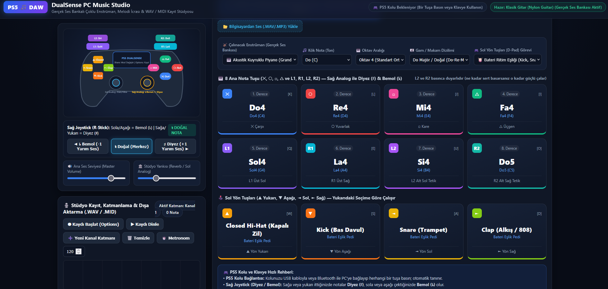

# 🎮 DualSense PC Music Studio (PS5 Controller DAW)

PS5 **DualSense** kontrolcüsünü (veya PC klavyesini) gerçek enstrüman ses bankalarıyla çalışan çok modlu bir müzik üretim stüdyosuna (DAW) dönüştüren masaüstü/web uygulaması.

---

## ✨ Özellikler

### 1. İki Farklı Çalışma Modu
* **🎼 MOD 2 — Doğrudan Nota Modu (8 Ana Tuş + Sağ Analog Diyez/Bemol + Yön Tuşları):**
  * Seçilen enstrümanda 8 ana tuş (`✕`, `○`, `□`, `△`, `L1`, `R1`, `L2`, `R2`) doğrudan seçilen gam/makamdaki 8 notayı (**Do, Re, Mi, Fa, Sol, La, Si, İnce Do**) çalar.
  * **Sağ Joystick (`R-Stick`) ile Diyez (`♯`) ve Bemol (`♭`):** Sağ analog çubuğu sağa/yukarı ittiğinizde basılan notalar **Diyez (`♯` / +1 yarım ses)**, sola/aşağı çektiğinizde **Bemol (`♭` / -1 yarım ses)** olur.
  * **Sol Yön Tuşları (`D-Pad`) için 3 Seçilebilir Fonksiyon:**
    1. **🥁 Bateri Ritim Eşliği:** Sağ elle melodi çalarken sol elle `Kick`, `Snare`, `Hi-Hat`, `Clap` ritim eşliği yapma.
    2. **🎶 Ekstra 4 Nota (12 Notalı Genişletilmiş Klavye):** Yön tuşlarıyla 4 ekstra nota daha çalarak toplam 12 notaya erişim.
    3. **⚡ Hızlı Oktav & Enstrüman Gezgini:** `▲ / ▼` ile oktav büyütüp küçültme, `◄ / ►` ile enstrüman değiştirme.
  * **L2 ve R2 Basınç Hassasiyeti (Velocity):** Tetiklere ne kadar sert basarsanız ses o kadar güçlü çıkar.
  * **Sol Joystick (`L-Stick`):** Canlı filtre parlaklığı (Low-Pass Cutoff) ve Stüdyo Yankısı (Reverb) kontrolü.

* **🎛️ MOD 1 — Serbest Enstrüman & Nota Atama Modu (12 Tuş Ayrı Enstrüman):**
  * Kol üzerindeki **12 tuşun tamamına** (`✕, ○, □, △, L1, R1, L2, R2` ve `Yön Tuşları`) ayrı ayrı istediğiniz enstrümanı, notayı, oktavı ve akor tipini (*Tek Nota, Majör Akor, Minör Akor, 7'li Akor, Power Chord*) atayabilirsiniz.
  * Hazır stüdyo şablonları: *Senfonik Orkestra Seti, Rock/Gitar Stüdyo Seti, Lo-Fi & 808 Beatmaker Seti, Akustik & Doğu Ezgileri Seti*.

### 2. Gerçek Ses Bankaları & Özel Ses Yükleme
* **MusyngKite General MIDI Ses Bankası** üzerinden 35'ten fazla gerçek enstrüman (*Akustik Kuyruklu Piyano, Rhodes EP, Klasik/Akustik/Elektro/Distortion Gitar, Solo Keman, Çello, Yaylı Orkestrası, Arp, Koro, Yan Flüt, Klarnet, Pan Flüt/Ney, Saksafon, Trompet, Kontrbas, Bas Gitar, 808 Sub Bass, Sitar, Kalimba, Synth Lead/Pad ve Stüdyo Bateri Seti*).
* Bilgisayardan kendi `.wav`, `.mp3`, `.ogg` veya `.flac` ses dosyalarınızı enstrüman olarak yükleyebilme.

### 3. Çok Kanallı Kayıt (Multi-Track Looper), `.WAV` ve `.MID` (MIDI) Çıktısı
* **Çok Kanallı Kayıt (`➕ Yeni Kanal Katmanı`):** Önce bateri ritmini kaydedip, üstüne farklı enstrümanlarla akor ve solo melodi katmanları ekleyebilirsiniz.
* **💾 `.WAV` İndir:** Kaydedilen performansı **44.1kHz 16-bit Stereo PCM `.wav`** ses dosyası olarak dışa aktarır.
* **🎼 `.MID` (MIDI) İndir:** Her enstrümanı kendi MIDI kanalına ayırarak standart **SMF Format 1 `.mid`** nota dosyası üretir (*FL Studio, Ableton Live, Cubase, Logic Pro, Reaper* vb. tüm DAW programlarıyla uyumludur).

---

## 🚀 Kurulum ve Çalıştırma

Herhangi bir ek kurulum gerektirmez:
1. PS5 DualSense kolunuzu USB kablo veya Bluetooth ile bilgisayarınıza bağlayın.
2. `baslat.bat` veya `index.html` dosyasına çift tıklayarak stüdyoyu açın.
3. Koldaki herhangi bir tuşa basın (veya PC klavyesini kullanın) ve hemen müzik üretmeye başlayın!
